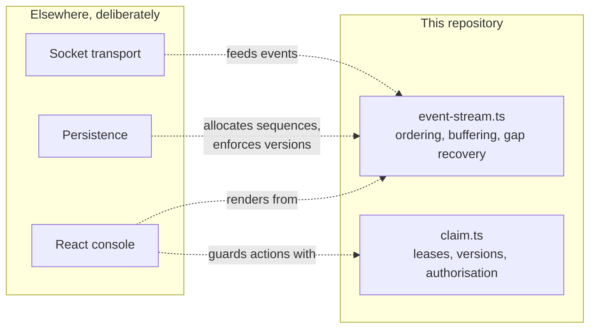
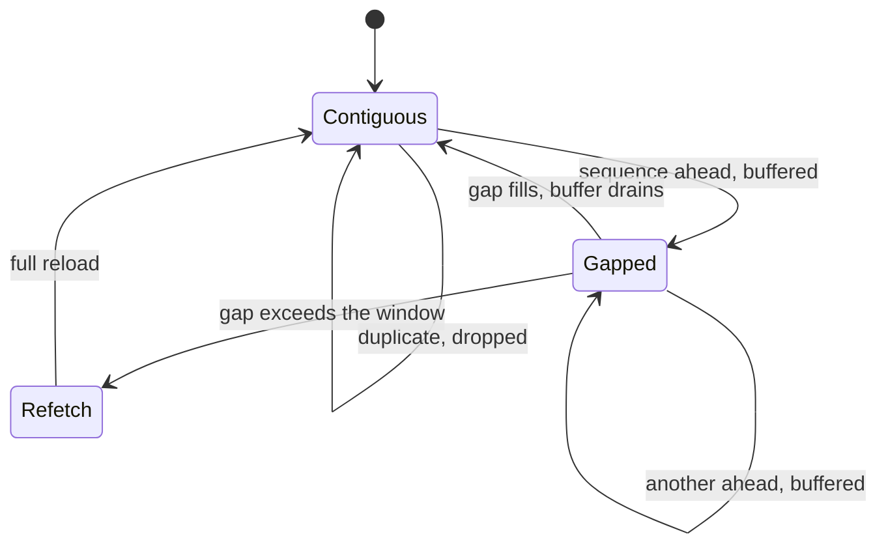

# Architecture

## Shape

Two pure modules and nothing else.



The dotted arrows are what a host application wires up. Nothing inside the box knows any of
it exists.

## Why there is no framework here

The hard part of an incident console is not rendering a list. It is deciding what to render
when events arrive twice, out of order, with a gap in the middle, while a second operator
is mutating the same record.

That decision is a function from state and an event to new state. Burying it in a component,
a store, a socket client and a database makes it much harder to test and no more correct. So
it stays a function, and the service is arranged around it rather than through it.

The service is deliberately thin: a NestJS module with controllers, a Socket.IO gateway and
a store port, none of which decide anything. It runs, and `test/service.spec.ts` drives the
concurrency rules over real HTTP to prove the decisions are actually wired to the transport.
That is a different claim from the decisions being correct, which is what the unit suite
covers.

What it does not carry is the console UI or a production persistence layer. Both are in the
flagship, and duplicating them here would blur the boundary this repository exists to keep
sharp.

## State model

```ts
StreamState = {
  applied: IncidentEvent[]   // contiguous, in sequence order
  buffered: IncidentEvent[]  // arrived early, waiting for the gap in front
  appliedThrough: number     // highest applied. The resume point
  droppedDuplicates: number  // diagnostic
}
```

The invariant that matters: `applied` is always contiguous. Everything else follows from
maintaining it.

```ts
ClaimState = {
  holderId, claimedAt, expiresAt   // the lease
  version                          // optimistic concurrency
}
```

Two independent guards, because they catch different failures. The table in
[docs/CONCURRENCY.md](docs/CONCURRENCY.md) enumerates the four cases.

## Transitions



## Decisions

**Immutable state.** Every function returns new state rather than mutating. It removes a
whole class of bug where a React render sees a half-applied update, and it makes the tests
trivially independent.

**Errors are values, not exceptions.** `ClaimResult` is a discriminated union. A caller has
to handle the conflict case to compile, which is the point: a conflict is a normal outcome
here, not an exceptional one.

**Messages, not codes.** `explain()` returns a sentence for the operator. An operator under
time pressure needs to know what happened and what to do, not which enum member came back.

**No fairness mechanism.** An operator can claim and release repeatedly to monopolise an
incident. Visible in the audit log, not prevented. Adding fairness needs a queue and a
policy, and both are more product decision than engineering one.

## What a host application has to provide

| Responsibility | Why not here |
|----------------|--------------|
| Allocating sequences | Must happen inside the writing transaction, so it belongs to the database |
| Enforcing versions on write | Same. `WHERE version = $n` is the enforcement; this module only decides |
| Transport and reconnection | Socket.IO already does reconnection well; this supplies the resume point |
| Persistence | Out of scope |
| Rendering | Out of scope |
