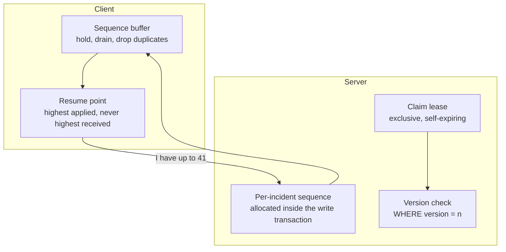

# guardianlink-incident-console

**What happens when two operators work the same incident at once, on a connection that
keeps dropping, with events arriving in the wrong order.**

> Part of the [GuardianLink portfolio](../PORTFOLIO.md). A demonstration, not a real
> safety service.

The flagship platform answers "can an operator work an incident". This repository answers
the harder question underneath it, and takes that one problem as far as it goes.

[](docs/test-results/)
[](LICENSE)

---

## The problem

An incident console has properties a normal CRUD screen does not:

- **Two operators, one incident.** Both open it, both start working, and without something
  in the way neither finds out until one overwrites the other.
- **An operator who walks away.** A claim with no expiry means an incident sits
  unavailable while nobody works it.
- **A flaky connection.** Sockets drop mid-incident. When one comes back, the client has
  a partial view and does not know what it missed.
- **Out-of-order delivery.** Mobile and proxy networks reorder. Rendering an operator note
  above the action it describes is worse than not rendering it yet.
- **Wrong clocks.** Device and server time disagree, so timestamps cannot order anything.

Each one has a specific mechanism here, and each mechanism has tests that describe the
failure it prevents rather than the method it calls.

## How it works



### Event ordering

Events carry a per-incident sequence allocated by the database inside the writing
transaction, so two concurrent writers cannot both decide they are number seven. The
client orders by it and never by a timestamp.

An event that is not the next one is **buffered, not applied**. When the gap fills, the
buffer drains in one pass. Anything at or below the highest applied sequence is dropped,
which makes duplicate delivery after a reconnect completely harmless.

The buffer is bounded. A client that has missed more than the replay window is told to
refetch rather than accumulating events that can never drain.

### Reconnection

On reconnect the client sends the highest sequence it has **applied**, not the highest it
has received. Those differ whenever something is sitting in the buffer, and sending the
wrong one skips events for ever. There is a test for exactly that.

### Claim leases

A claim is exclusive while held and expires on its own after five minutes. Re-claiming your
own incident extends the lease and emits nothing new, because operators keep a tab open for
a long time and a timeline full of "claimed by the same person again" is noise.

Mutations are guarded by **two** independent checks:

- **Version**: is this operator acting on a current view of the incident?
- **Lease**: does this operator currently hold it?

They catch different failures. An operator can hold the claim and still be looking at a
stale incident; another can be up to date and have had the claim taken from them. Either
check alone leaves a real hole, and there is a test per case.

## Running it

```bash
pnpm install
pnpm verify        # lint, type-check, tests
```

No database, no Redis, no browser, no Docker. The logic under test is pure, which is the
point: two operators racing is a unit test here, not something you reproduce by hand with
two browser windows and good timing.

## Test coverage

40 tests, all passing. Each is named after the failure it prevents.

| Area | Cases |
|------|-------|
| In-order delivery | Contiguous application |
| Out-of-order | Buffering, draining, a fully reversed stream, gap reporting |
| Duplicates | Replay of applied, replay of buffered, chaotic arrival order |
| Reconnection | Resume point correctness, batch replay, nothing lost across a drop |
| Bounded buffering | Refetch past the window, no refetch for a small gap |
| Claim | Take, refuse, lapse, renew, boundary instant, stale version |
| Lease timing | Renewal window, non-holder never renews |
| Authorisation | Holder with current version, non-holder, taken over, stale view |
| Racing | Both claim from version 0; exactly one wins, twice, for different reasons |
| Messages | Names the holder, gives a countdown, never shows a negative one |

Recorded output: [docs/test-results/](docs/test-results/).

## Why not just reuse the flagship console

The flagship's console is a product feature: it shows a queue, opens an incident, and
lets an operator work it. It solves the concurrency problem well enough to ship.

This repository takes the same problem and asks what happens at the edges: at the exact
instant a lease expires, when a batch arrives reversed, when the resume point is computed
from the wrong number, when two requests carry the same stale version. Those are the cases
that are tedious to reproduce and easy to get wrong, and they are the whole content here.

## Deliberately not here

Accounts, mobile apps, subscriptions, billing, notification delivery, AWS. Devices are a
generator script. If it is not about two operators touching one incident at the same time,
or about events arriving in the wrong order, it does not belong.

## Known limitations

- **The transport is not implemented here.** The pure logic is; the Socket.IO wiring lives
  in the flagship. This repository is deliberately the part you can test without a socket.
- **No UI.** The view-model logic for a queue is in the flagship's `apps/web`. Adding a
  second copy here would blur the boundary this repository exists to keep sharp.
- **The lease duration is a judgement call.** Five minutes, with no data to tune it
  against. Stated as a guess rather than presented as a finding.
- **No fairness.** An operator who repeatedly claims and releases can monopolise an
  incident. Visible in the audit log, not prevented.

## Further reading

- [docs/CONCURRENCY.md](docs/CONCURRENCY.md): the full write-up, including why version
  and lease are both needed
- [docs/ARCHITECTURE.md](docs/ARCHITECTURE.md)

## Suggested repository metadata

**Description:** Multi-operator incident console: event ordering, claim leases, optimistic
concurrency and reconnection recovery, with tests for every failure mode.

**Topics:** `typescript` `concurrency` `optimistic-locking` `event-sourcing` `websockets`
`distributed-systems` `testing` `portfolio`

## Licence

[MIT](LICENSE).
