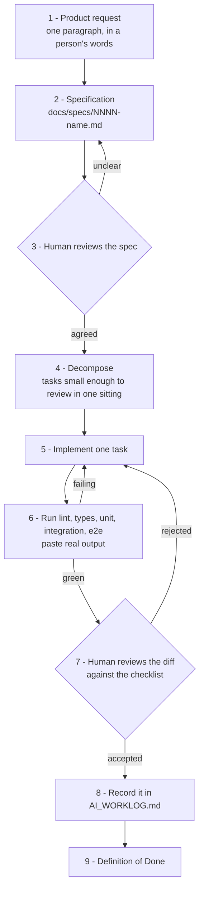

# AI-assisted engineering workflow

The workflow exists because an AI agent produces plausible code faster than a human can review it.
Everything below is aimed at keeping the review real rather than nominal.



## 1. The product request

One paragraph describing a situation a person is in. Not a feature description. "A contact who
misses the first alert should get a second one" is a request; "add an escalation service" is already
a solution and forecloses the design conversation.

## 2. The specification

Written before any code, in `docs/specs/`, following [TASK_TEMPLATE.md](TASK_TEMPLATE.md). It has to
answer:

- **Scope**, and explicitly what is out of scope
- **Affected systems**: which apps, which modules, which tables
- **Acceptance criteria**, each one checkable by running or reading something specific
- **Security considerations**: what new data, who can see it, what new authorisation decision
- **Required tests**, including the failure paths
- **Definition of Done**

An agent may write the spec. A human agrees it before implementation begins. That gate is the whole
point: it is the last moment where changing direction is cheap.

## 3. Reviewing the specification

Look for: an acceptance criterion that cannot be checked; a security section that says "none" without
justification; missing failure paths; scope that has quietly grown.

## 4. Decomposition

Tasks small enough that a human can genuinely review the diff in one sitting. A 900-line diff gets
skimmed, and a skimmed diff is an unreviewed diff. Roughly: one layer, one behaviour, one commit.

Independent tasks can run in parallel worktrees. See [WORKTREES.md](WORKTREES.md).

## 5. Implementation

The agent works one task at a time and says which files it intends to touch first.

## 6. Verification

Real commands, real output, pasted. Not "the tests should pass". Not a summary of what the output
would say.

```bash
pnpm lint
pnpm typecheck
pnpm --filter @guardianlink/api test
pnpm --filter @guardianlink/api test:e2e
```

A failing test is fixed by understanding the cause. Changing the assertion so it passes is the single
worst thing that can happen in this workflow, and it is also the easiest, so it is called out
explicitly.

## 7. Human review

Against [REVIEW_CHECKLIST.md](REVIEW_CHECKLIST.md), which covers security, privacy, error handling,
concurrency, data consistency, accessibility, performance, maintainability, backward compatibility
and test coverage.

The question is never "does this work". It is "what would make this wrong, and does anything catch
that". Generated code is fluent, idiomatic and confident, which makes it read as more correct than it
is. Being fluent about an authorisation check that is in the wrong layer is exactly the failure mode.

## 8. Recording it

`AI_WORKLOG.md` records what was delegated, what context was given, what came back, what was
rejected, what was corrected, which tests failed and how. A worklog with no rejections in it means
nobody was reviewing, not that the agent did unusually well.

## 9. Definition of Done

In [../../CONTRIBUTING.md](../../CONTRIBUTING.md) and the pull-request template. Same bar as any
other contribution. There is no lighter standard for generated code; if anything there is a heavier
one, because nobody was accountable while it was being written.

## What this workflow is defending against

| Failure | How the workflow catches it |
|---------|-----------------------------|
| Code that compiles and is wrong | Failure-path tests, human review against a fixed checklist |
| An authorisation check in the wrong layer | Explicit checklist item, and it is the first one |
| Scope creep mid-task | Spec agreed before implementation; changing it needs a new round |
| A test written to match the code | Tests specified before implementation |
| Sensitive data in logs | Redaction with its own tests, plus a checklist item |
| An unreviewable diff | Decomposition into single-sitting tasks |
| Losing track of what was actually verified | The worklog and `docs/test-results/` |
| Quiet assumptions | The spec has an Assumptions section and it is expected to be non-empty |
